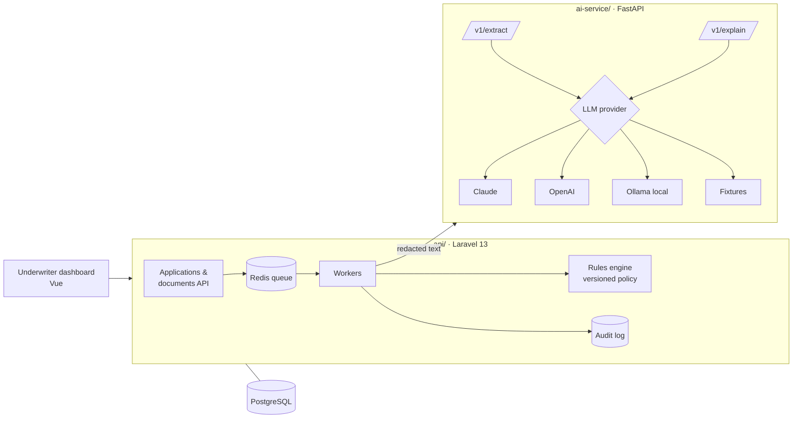

# loan-underwriting-ai

A consumer-loan underwriting platform where **AI reads the documents and explains the decision, but
deterministic rules make it.**

An applicant uploads paystubs and bank statements. An AI service extracts income, pay frequency and next pay
date into validated structured data. A versioned rules engine decides approve / refer / decline. An LLM writes the
plain-English explanation for the underwriter and the applicant. Every step is audit-logged, and PII never
reaches the model.

> **Status: in active development.** Built in public, one pull request per milestone. See [Roadmap](#roadmap).

## Architecture



| Component | Responsibility |
|---|---|
| `api/` (Laravel 13, PHP 8.4) | Applications, document uploads, queue workers, **rules engine**, decisions, audit trail, PII encryption at rest |
| `ai-service/` (FastAPI, Python 3.12) | Document → structured data extraction with schema validation; decision explanations. Pluggable LLM providers |
| PostgreSQL | System of record (JSONB for extracted fields) |
| Redis | Queue for document processing |

The full design is in [docs/architecture.md](docs/architecture.md). Key decisions are recorded as ADRs:

- [ADR-0001](docs/adr/0001-rules-decide-llm-explains.md): Rules decide, the LLM only extracts and explains
- [ADR-0002](docs/adr/0002-separate-python-ai-service.md): A separate Python AI service, not LLM calls inside Laravel
- [ADR-0003](docs/adr/0003-pluggable-llm-providers.md): Pluggable LLM providers with a deterministic fixture provider for tests
- [ADR-0004](docs/adr/0004-pii-never-reaches-the-model.md): PII is redacted before any text reaches a model

## Quick start

Requires Docker only. No API keys needed: the AI service defaults to the deterministic `fixture` provider.

```bash
make key        # writes APP_KEY to .env
make up         # postgres, redis, api (:8000), worker, ai-service (:8001)
make migrate
make test       # Laravel (Pint + tests) and ai-service tests, in containers
```

For a real local model: set `LLM_PROVIDER=ollama` in `.env`, then run `docker compose --profile local-llm up -d`.
For hosted models, set `LLM_PROVIDER=anthropic` or `openai` along with the matching API key.

## Roadmap

| # | Milestone | Status |
|---|---|---|
| 1 | Monorepo skeleton: Laravel API, FastAPI service, Docker Compose, CI | in progress |
| 2 | Loan application domain: applicants, applications, documents API + tests | planned |
| 3 | AI service: provider interface (Claude / OpenAI / Ollama / fixtures), `/v1/extract` with schema validation | planned |
| 4 | Document pipeline: upload → queue → redact → extract → store | planned |
| 5 | Rules engine (versioned policy) + `/v1/explain` | planned |
| 6 | PII encryption at rest + audit trail | planned |
| 7 | Underwriter dashboard (Vue) + demo | planned |

## Why this project

I lead engineering on a US consumer-lending and underwriting platform. This repo is a **clean-room**
build in the same domain: no employer code or data. It shows how I'd put LLMs into a regulated
decision flow: models where they're strong (reading messy documents, writing explanations), deterministic
code where decisions must be reproducible and auditable.

## Licence

MIT
