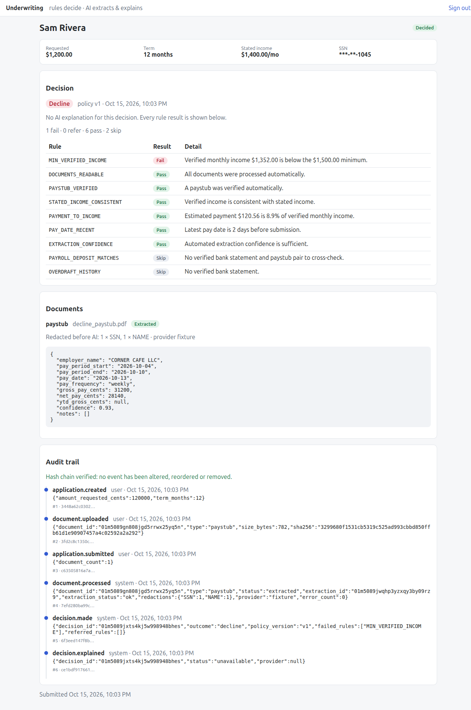
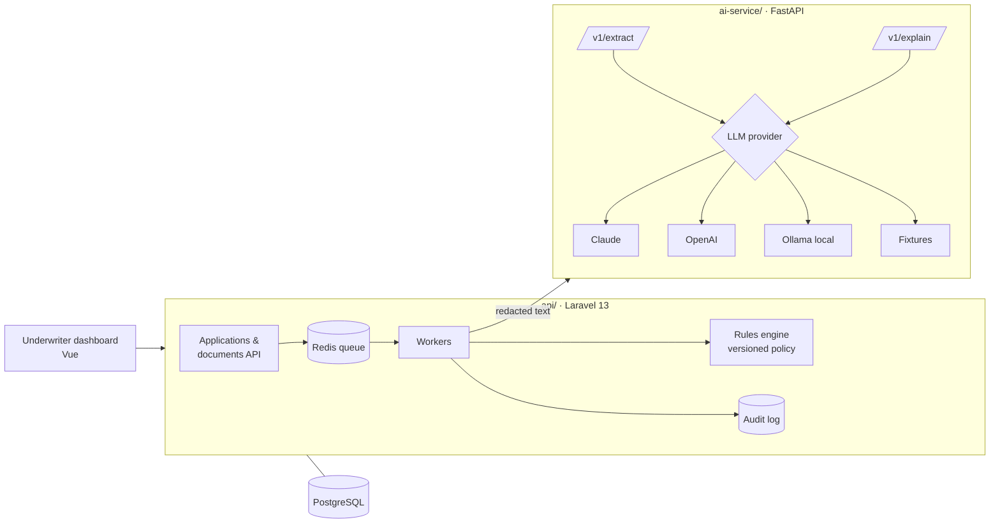
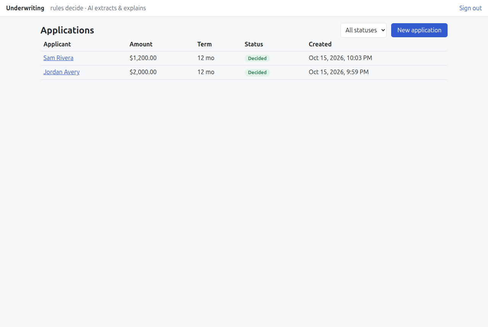
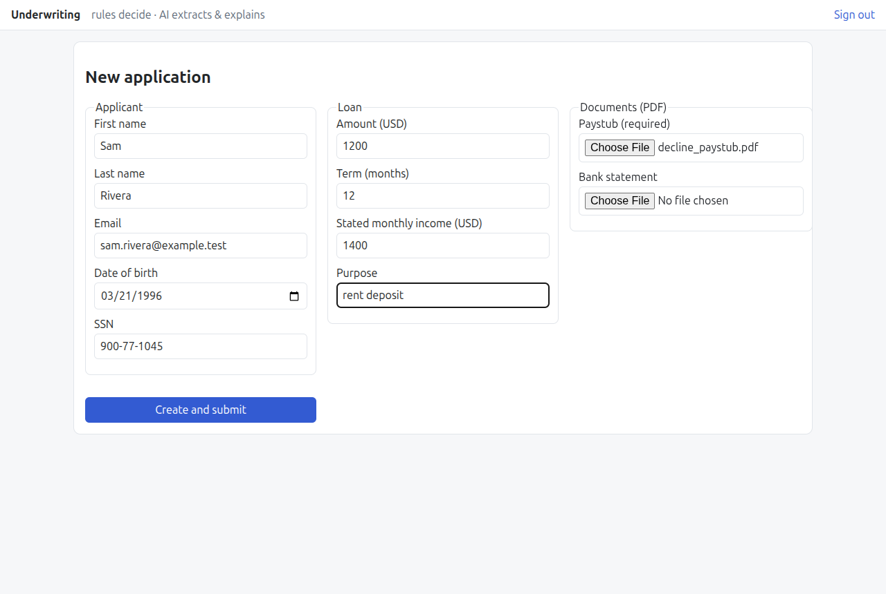
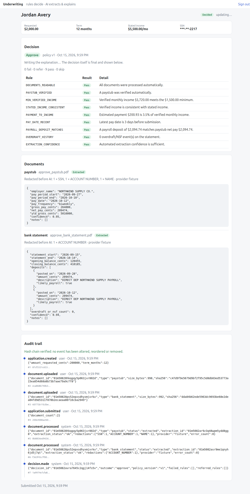

# loan-underwriting-ai

A consumer-loan underwriting platform where **AI reads the documents and explains the decision, but
deterministic rules make it.**

An applicant uploads paystubs and bank statements. An AI service extracts income, pay frequency and next pay
date into validated structured data. A versioned rules engine decides approve / refer / decline. An LLM writes the
plain-English explanation for the underwriter and the applicant. Every step is audit-logged, and PII never
reaches the model.

> Built in public, one pull request per milestone. See [Roadmap](#roadmap).



## API (so far)

All routes require a Sanctum bearer token. Money is in integer cents.

| Method | Route | Purpose |
|---|---|---|
| `POST` | `/api/applications` | Create a draft application with its applicant (SSN and DOB are encrypted at rest and never returned) |
| `GET` | `/api/applications?status=` | Paginated list, newest first |
| `GET` | `/api/applications/{id}` | One application with its masked applicant and documents |
| `POST` | `/api/applications/{id}/documents` | Upload a `paystub` or `bank_statement` (PDF/PNG/JPEG, 10 MB max). Stored privately; duplicates rejected by SHA-256 |
| `GET` | `/api/applications/{id}/audit` | The application's audit trail, plus `chain_intact` (hash chain re-verified on read) |
| `POST` | `/api/applications/{id}/submit` | Lock the application and queue document processing (requires at least one paystub) |

Submitting dispatches one `ProcessDocument` job per document as a failure-tolerant **job batch**. Each job reads the PDF's text layer, **redacts PII** (SSN, account/routing/card numbers, email, phone, DOB) and calls the AI service. It then stores an `extraction` (data, errors, what was redacted, by type and count only) on the document. Outages retry with backoff (10s/60s/300s). Unreadable files (scans/images until OCR lands) go to `needs_review`. When the batch finishes, `ApplicationDocumentsProcessed` fires for the rules engine.

### Underwriting decision (policy v1)

When all documents are processed, `MakeDecision` builds **facts** from *validated* extractions only, and runs every
rule (no short-circuit). Any **fail** → `decline`, else any **refer** → `refer`, else `approve`. The decision stores
the policy version, every rule result and the facts snapshot, so it **replays identically** (there's a test for that).
Explanations are generated afterwards by `ExplainDecision`. If the AI is down, the decision still stands.

| Rule | Refer / fail when |
|---|---|
| `DOCUMENTS_READABLE` | refer if any document needs manual review |
| `PAYSTUB_VERIFIED` | refer if no paystub verified, or frequency/gross missing |
| `MIN_VERIFIED_INCOME` | **fail** below $1,500/month verified gross |
| `STATED_INCOME_CONSISTENT` | refer if stated income exceeds verified by >20% (under-stating is fine) |
| `PAYMENT_TO_INCOME` | refer above 15%, **fail** above 25% (amortised estimate at 36% APR) |
| `PAY_DATE_RECENT` | refer if latest pay date is >45 days before submission, or after it |
| `PAYROLL_DEPOSIT_MATCHES` | refer if no payroll deposit is within 5% of paystub net pay |
| `OVERDRAFT_HISTORY` | refer at ≥3 overdraft/NSF events |
| `EXTRACTION_CONFIDENCE` | refer if any extraction confidence is <0.70 (low confidence never declines) |

`POST /v1/explain` receives the outcome and rule codes/messages only, never applicant data. It returns an
underwriter summary, a plain-language applicant message (validated to contain no internal rule codes, retried
once if it does) and up to 4 principal reasons for declines.

### AI service

`POST /v1/extract` with `{"document_type": "paystub" | "bank_statement", "text": "<redacted text>"}` returns
validated, typed fields (money in cents, ISO dates, a confidence score and notes for the underwriter).

- Each vendor's native structured output is used: Claude `output_config.format` (`claude-opus-5-5`, with
  server-side refusal fallback), OpenAI strict `json_schema`, and Ollama schema-constrained decoding.
- Pydantic re-validates every answer, including business rules such as net pay ≤ gross pay. Invalid output gets
  **one corrective retry with the validation errors**. Still invalid, or refused by the model, means `needs_review`
  for a human. It is never passed downstream.
- Provider outages return `502`, so the Laravel worker retries later. A bad document never causes a retry loop.
- CI uses the `fixture` provider: golden answers for the synthetic samples in `ai-service/tests/samples/`,
  keyed by a hash of prompt + document + schema, so any prompt change shows up as fixture changes in review.

## Architecture



| Component | Responsibility |
|---|---|
| `api/` (Laravel 13, PHP 8.4) | Applications, document uploads, queue workers, **rules engine**, decisions, audit trail, PII encryption at rest |
| `ai-service/` (FastAPI, Python 3.12) | Document → structured data extraction with schema validation; decision explanations. Pluggable LLM providers |
| PostgreSQL | System of record (JSONB for extracted fields) |
| Redis | Queue for document processing |

The full design is in [docs/architecture.md](docs/architecture.md). Key decisions are recorded as ADRs:

- [ADR-0001](docs/adr/0001-rules-decide-llm-explains.md): Rules decide, the LLM only extracts and explains
- [ADR-0002](docs/adr/0002-separate-python-ai-service.md): A separate Python AI service, not LLM calls inside Laravel
- [ADR-0003](docs/adr/0003-pluggable-llm-providers.md): Pluggable LLM providers with a deterministic fixture provider for tests
- [ADR-0004](docs/adr/0004-pii-never-reaches-the-model.md): PII is redacted before any text reaches a model
- [ADR-0005](docs/adr/0005-hash-chained-append-only-audit-trail.md): Hash-chained, append-only audit trail

## Demo (no API key needed)

```bash
make key && make up && make migrate
make demo                       # prints an API token
open http://localhost:5173      # paste the token, then "New application"
```

Upload the PDFs in [`demo/documents/`](demo/documents) to see both outcomes end to end:

| Applicant | Documents | Outcome |
|---|---|---|
| any name, $2,000 / 12 mo, stated income $5,500 | `approve_paystub.pdf` + `approve_bank_statement.pdf` | **approve**: all 9 rules pass, payroll deposit matches net pay |
| any name, $1,200 / 12 mo, stated income $1,400 | `decline_paystub.pdf` | **decline**: verified income $1,352/mo is below the $1,500 minimum |

With the default `fixture` provider, the AI answers for these demo documents come from golden fixtures keyed by
their exact redacted text (`demo/redacted/`, produced by `php artisan pii:preview`). Other documents, and the prose
explanations of new decisions, need a real model (`LLM_PROVIDER=anthropic|openai|ollama`). Without one, the
dashboard shows those explanations as unavailable, and the decision still stands. The demo pay dates are fixed, so
`PAY_DATE_RECENT` starts referring once they're more than 45 days old.

| Applications | New application | Approved |
|---|---|---|
|  |  |  |

## Quick start

Requires Docker only. No API keys needed: the AI service defaults to the deterministic `fixture` provider.

```bash
make key        # writes APP_KEY to .env
make up         # postgres, redis, api (:8000), worker, ai-service (:8001)
make migrate
make test       # Laravel (Pint + tests) and ai-service tests, in containers
```

For a real local model: set `LLM_PROVIDER=ollama` in `.env`, then run `docker compose --profile local-llm up -d`.
For hosted models, set `LLM_PROVIDER=anthropic` or `openai` along with the matching API key.

## Roadmap

| # | Milestone | Status |
|---|---|---|
| 1 | Monorepo skeleton: Laravel API, FastAPI service, Docker Compose, CI | ✅ done (#1) |
| 2 | Loan application domain: applicants, applications, documents API, PII encrypted at rest | ✅ done (#2) |
| 3 | AI service: provider interface (Claude / OpenAI / Ollama / fixtures), `/v1/extract` with schema validation | ✅ done (#3) |
| 4 | Document pipeline: submit → batch of queue jobs → PDF text → PII redaction → `/v1/extract` → stored extraction | ✅ done (#4) |
| 5 | Rules engine (versioned policy) + `/v1/explain` | ✅ done (#5) |
| 6 | Hash-chained, append-only audit trail (PII redaction shipped in #4) | ✅ done (#6) |
| 7 | Underwriter dashboard (Vue 3 + TS), demo pack, end-to-end run via `docker compose` | ✅ done (#7) |

## Why this project

I lead engineering on a US consumer-lending and underwriting platform. This repo is a **clean-room**
build in the same domain: no employer code or data. It shows how I'd put LLMs into a regulated
decision flow: models where they're strong (reading messy documents, writing explanations), deterministic
code where decisions must be reproducible and auditable.

## Licence

MIT
