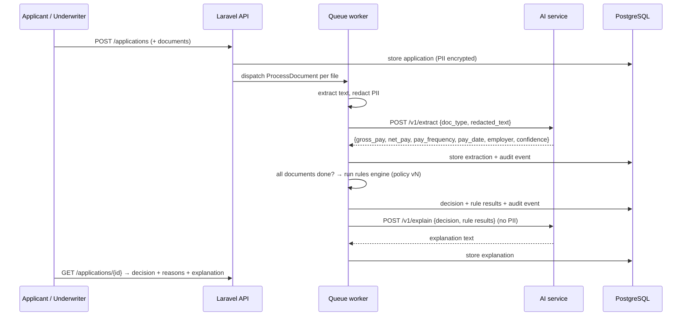

# Architecture

## Goals

1. **Reproducible decisions.** The same application plus the same policy version always gives the same decision.
2. **Auditable.** Every extraction, rule evaluation and decision is recorded with the inputs that produced it.
3. **Safe with PII.** SSNs, account numbers and similar never leave the API's trust boundary unredacted.
4. **Provider-agnostic AI.** Swap Claude / OpenAI / a local model by configuration. Tests never call a network model.

## Decision flow

## Rules engine

- Policies are versioned PHP classes (`UnderwritingPolicyV1`, …). Each rule returns
  `pass | refer | fail` with a machine-readable reason code and the values it used.
- Example rules: minimum verified monthly income, debt-to-income ceiling, pay-date consistency across
  documents, income agreement between paystub and bank deposits (within tolerance), extraction confidence floor.
- Low-confidence extractions never auto-decline. They **refer** to a human.
- The decision stores the policy version and every rule result, so it can be replayed exactly.

## AI service contract

- `POST /v1/extract`: input `{document_type, text}`; output validated against a Pydantic schema per document type.
  Invalid model output is retried once with the validation errors, then fails as `needs_review`.
- `POST /v1/explain`: input is the decision and rule results only; output is a short explanation for the underwriter
  and a separate applicant-facing version (plain language, no internal thresholds).
- The provider is chosen by `LLM_PROVIDER=anthropic|openai|ollama|fixture`. `fixture` returns recorded
  responses keyed by input hash, which is what CI uses.

## Data model (initial)

`applicants` (PII columns encrypted) · `loan_applications` · `documents` · `extractions` (JSONB) ·
`decisions` (policy_version, outcome, rule_results JSONB) · `audit_events` (append-only).

## Out of scope (deliberately)

Credit bureau pulls, payments/servicing, and real e-signature. These are integration-heavy and not what
this project is about.
